# Codex Unified Model Router

[](https://github.com/mirzahusadzic/codex-unified-model-router/actions/workflows/ci.yml)
[](LICENSE)


A loopback-only router that lets one Codex thread switch between native OpenAI, DeepSeek, Anthropic Claude, Meta Muse Spark, and configured OpenRouter models through Codex’s existing model picker. It normalizes mixed-provider messages, tool calls, reasoning state, and structured output; preserves the selected model; streams responses; performs bounded recovery for rejected or oversized OpenRouter requests; and runs web search through the router so later turns retain the results. Training-tier Muse and Ultra Spark sessions are isolated from OpenAI and Claude sessions, with additional fork-context safeguards for spawned workers. Includes cross-platform installers and verifiers, configuration backups, daemon pinning, Linux/macOS/Windows CI, and no npm runtime dependencies.

- **Switch models in place:** OpenAI, DeepSeek, Claude, Muse, Ultra Spark, and cataloged OpenRouter models.
- **Agent orchestration:** Ultra Spark lets DeepSeek coordinate up to 10 Muse Spark workers with `fork_context: false`.
- **Privacy boundaries:** Training-tier sessions cannot mix with native OpenAI or Claude sessions.
- **Provider compatibility:** Repairs reasoning and tool history, handles DeepSeek JSON-mode structured output, normalizes problematic tool arguments, and never silently substitutes models.
- **Resilient streaming:** Bounded OpenRouter recovery, context-overflow signaling for Codex compaction, router diagnostics, and disconnect cancellation.
- **Router-run web search:** Converts Codex’s hosted search tool into an OpenRouter function, retains results per session, and restores them in later turns.
- **Local operations:** Loopback binding, token authentication, private credential storage, launchd/systemd/Windows startup, backups, verifiers, and daemon version pinning.
- **Minimal footprint:** Node.js 20+, zero npm runtime dependencies.

## How it works

Codex talks to the router as one model provider. The router picks the upstream from the model slug, adapts each request to that provider, and streams the response back. Native OpenAI and Claude models never share a tracked Codex session with training-tier models; requests without a session ID are not tracked.

**Key:** 🟢 router · 🟡 OpenRouter · 🔵 DeepSeek · 🟠 Anthropic · ⚪ OpenAI · 🔴 training tier, where Meta trains on the inputs.

```mermaid
---
config:
    layout: elk
    look: neo
    flowchart:
        wrappingWidth: 400
    themeCSS: >-
        foreignObject { overflow: visible; }
        code { font-family: ui-monospace, SFMono-Regular, "SF Mono", Menlo,
        Consolas, monospace; font-size: 0.9em; line-height: inherit;
        color: inherit !important; text-shadow: none !important;
        padding: 0 4px; border-radius: 4px;
        background: color-mix(in srgb, currentColor 14%, transparent)
        !important; }
        .edgeLabel, .edgeLabel p, .edgeLabel span {
        background: transparent !important; }
        .edgeLabel rect { fill: transparent !important; }
        .labelBkg { --knock: var(--vscode-editor-background,
        var(--bgColor-default, rgb(from currentColor
        clamp(30, (128 - r) * 100, 255) clamp(30, (128 - r) * 100, 255)
        clamp(30, (128 - r) * 100, 255)))); --ring: var(--knock);
        --fill: color-mix(in srgb, var(--ring) 30%, var(--knock));
        background: var(--fill) !important; border-radius: 4px;
        box-shadow: 0 0 0 5px var(--fill), 0 0 0 7px var(--ring); }
        .label[data-id^="L_CX_RT_"] .labelBkg {
        --ring: #2e9e5b; }
        .label[data-id^="L_RT_OR_"] .labelBkg {
        --ring: #e3a008; }
        .label[data-id^="L_RT_OA_"] .labelBkg {
        --ring: #b5bcc6; }
        .label[data-id^="L_US_MU_"] .labelBkg,
        .label[data-id^="L_OA_TT_"] .labelBkg {
        --ring: #c94a4a; }
        .edgeLabel p, .edgeLabel span, .edgeLabel text {
        --halo: var(--fill, var(--vscode-editor-background,
        var(--bgColor-default,
        rgb(from currentColor clamp(0, (128 - r) * 100, 255)
        clamp(0, (128 - r) * 100, 255) clamp(0, (128 - r) * 100, 255)))));
        text-shadow: 1px 0 var(--halo), -1px 0 var(--halo),
        0 1px var(--halo), 0 -1px var(--halo), 1px 1px var(--halo),
        -1px -1px var(--halo), 1px -1px var(--halo), -1px 1px var(--halo),
        0 0 3px var(--halo), 0 0 4px var(--halo); }
---
flowchart LR
    CX["<b>Codex</b><br/>CLI and app-server"]
    RT["<b>Unified Model Router</b><br/>127.0.0.1, local token"]
    OR["<b>OpenRouter</b><br/>your API key"]
    AN["<b>Anthropic API</b><br/>optional Console key"]
    OA["<b>ChatGPT Codex backend</b><br/>needs a ChatGPT plan"]
    DS["<b>DeepSeek V4.1 Flash</b><br/>default"]
    CL["<b>Claude Sonnet · Opus 5.5</b><br/>Anthropic, prompt-cached"]
    AM["<b>Any OpenRouter model</b><br/>with a catalog entry"]
    subgraph TT["Training tier"]
        US["<b>Ultra Spark</b><br/>DeepSeek leading workers"]
        MU["<b>Muse Spark 1.3 Contributor</b><br/>Meta, trains on inputs"]
    end
    CX -->|"Responses API"| RT
    RT -->|"deepseek/ · ultra-spark/ · openrouter/"| OR
    RT -->|"native models"| OA
    RT -->|"anthropic/ with a Console key"| AN
    AN --> CL
    OR --> DS
    OR -->|"without a Console key"| CL
    OR --> AM
    OR --> US
    US -->|"spawns up to 10 workers"| MU
    OA -.-|"never in one session, spawned agents included"| TT
    CL -.-|"never in one session"| TT

    classDef default fill:#8a96a82e,stroke:#8a96a8,stroke-width:1px
    classDef router fill:#2e9e5b4d,stroke:#2e9e5b,stroke-width:2px
    classDef openrouter fill:#e3a0084d,stroke:#e3a008,stroke-width:2px
    classDef deepseek fill:#4d6bfe4d,stroke:#4d6bfe,stroke-width:2px
    classDef openai fill:#ffffff40,stroke:#b5bcc6,stroke-width:2px
    classDef anthropic fill:#d977574d,stroke:#d97757,stroke-width:2px
    classDef training fill:#c94a4a4d,stroke:#c94a4a,stroke-width:2px
    classDef trainingTier fill:#c94a4a14,stroke:#c94a4a,stroke-width:2px,stroke-dasharray:6 4
    class RT router
    class OR,AM openrouter
    class DS,US deepseek
    class CX,OA openai
    class AN,CL anthropic
    class MU training
    class TT trainingTier
```



<p align="center"><em>All requests go through the router; labels show the route. The dotted lines keep training-tier models out of native OpenAI and Claude sessions.</em></p>

## Install

Requires Codex CLI (tested with **0.166.0**), **Node.js 20+**, and an **OpenRouter API key**. Windows also needs PowerShell 5.1 or later.

```sh
npm install -g @openai/codex@0.166.0    # skip if you already have Codex 0.166.0
git clone https://github.com/mirzahusadzic/codex-unified-model-router.git
cd codex-unified-model-router
node install.mjs                        # asks for your OpenRouter API key on the first install
node install.mjs --verify
```

`install.mjs` runs the installer for your platform from [`platform/`](platform/README.md). Common variations:

```sh
node install.mjs --change-api-key                    # replace the stored OpenRouter key; asks for the new one
node install.mjs --api-key-file ~/openrouter.key     # read the key from a file instead of asking
CODEX_ROUTER_NATIVE_MODELS=hide node install.mjs     # hide native OpenAI models from /model
CODEX_ROUTER_DISABLE_ANALYTICS=0 node install.mjs    # keep Codex analytics on
```

On an existing Codex configuration, the installer asks before merging into it and backs it up first. By default, it also hides native OpenAI models when Codex's login shows no active ChatGPT plan, turns off Codex analytics, ChatGPT connector tools, and the guardian that sends transcripts to OpenAI for review, and allows 10 parallel agents. `node install.mjs --help` summarizes the options; [Installer settings](docs/setup.md#installer-settings) explains each one with its default.

**Start a new thread after installation.** The installer restarts a running Codex app-server daemon for you and pins it to the CLI's Codex, so it no longer updates itself to versions the router has not been tested with ([why](docs/setup.md#daemon-updates)); restart other open Codex windows yourself ([details](docs/setup.md#activate-the-provider)).

## Use

```sh
codex                                                   # DeepSeek V4.1 Flash 1017
codex -m ultra-spark/deepseek-v4.1-flash-1017           # Ultra Spark mode
codex -m openrouter/meta/muse-spark-1.3-contributor     # Muse Spark 1.3 Contributor
codex -m anthropic/claude-sonnet-5-5                    # Claude Sonnet 5.5
codex -m anthropic/claude-opus-5-5                      # Claude Opus 5.5
```

| Model | Best for |
| --- | --- |
| **DeepSeek V4.1 Flash 1017** (default) | Everyday agentic coding with a long context. [Details](docs/setup.md#deepseek-context-window) |
| **DeepSeek · Ultra Spark** | Broad tasks such as reviews, audits, and changes across many files. [Details](docs/setup.md#ultra-spark-mode) |
| **Muse Spark 1.3 Contributor** | Fast, inexpensive work on public code. [Details](docs/setup.md#muse-spark-13-contributor) |
| **Claude Sonnet 5.5 · Claude Opus 5.5** | Hard problems that need Anthropic's models; prompt caching keeps long threads affordable. Runs on Anthropic's API when you add `ANTHROPIC_API_KEY` to the [router settings](docs/setup.md#router-settings), otherwise on OpenRouter. [Details](docs/setup.md#claude-sonnet-55-and-claude-opus-55) |
| **Any `openrouter/<vendor>/<model>`** | Trying another model; [add a catalog entry](docs/setup.md#add-a-model) to list it in `/model`. |
| **Native OpenAI**, such as `gpt-6-astra` | Requires a ChatGPT plan. |

Muse and the Ultra Spark workers use Meta's contributor tier, which trains on everything it receives, so use them only for code you are willing to share. The router refuses to mix them with native OpenAI or Claude models in a tracked Codex session; requests without a session ID are not tracked ([details](docs/setup.md#provider-isolation)).

Without a ChatGPT login, add `--profile unified-openrouter` to any of the commands above, Ultra Spark included ([details](docs/setup.md#openrouter-only-profile)). To prefer specific OpenRouter endpoints, set [`CODEX_ROUTER_PROVIDER_ORDER`](docs/setup.md#openrouter-endpoint-preferences).

## Develop

```sh
node --test
```

CI tests Linux, macOS, and Windows, checks script syntax, and validates the model catalog. Tests need no API keys or network access.

---

[Setup & configuration](docs/setup.md) · [Services & troubleshooting](docs/operations.md) · [Contributing](CONTRIBUTING.md) · [Security](SECURITY.md) · [Apache-2.0](LICENSE) · [Notices](NOTICE)
