# Codex Unified Model Router

[](https://github.com/mirzahusadzic/codex-unified-model-router/actions/workflows/ci.yml)
[](LICENSE)


Run Codex on DeepSeek, Meta's Muse Spark 1.3 Contributor, or any OpenRouter model, and switch between them in the middle of a thread, through a small local router.

- **DeepSeek by default.** DeepSeek V4.1 Flash 1017 with a 960,000-token context (912,000 effective at 95%). Prompts stay cache-friendly, so long agent sessions read most of each prompt from cache.
- **Ultra Spark mode.** DeepSeek leads and up to 10 Muse Spark 1.3 Contributor workers handle reviews, searches, and test runs in parallel; DeepSeek checks their findings before it reports them.
- **Switch in place.** `/model` moves a thread between DeepSeek, Muse, any `openrouter/<model>`, and native OpenAI models. Tool calls and reasoning history are repaired for each provider.
- **Hard to break.** A rejected request gets one bounded retry, a context overflow triggers Codex's compaction instead of a dead thread, and requests never silently switch to another model.
- **Private by default.** Codex analytics and its OpenAI-hosted guardian reviewer are off, and native OpenAI models never share a tracked Codex session with a provider that trains on its inputs.
- **Lean.** The installer turns off Codex's ChatGPT connector tools, about 65,000 tokens per request, and allows 10 parallel agents. Loopback only, streaming, zero npm dependencies.

## How it works

Codex talks to the router as one model provider. The router picks the upstream from the model slug, adapts each request to that provider, and streams the response back. Native OpenAI and training-tier models never share a tracked Codex session; requests without a session ID are not tracked.

**Key:** 🟢 router · 🟡 OpenRouter · 🔵 DeepSeek · ⚪ OpenAI · 🔴 training tier, where Meta trains on the inputs.

```mermaid
---
config:
    layout: elk
    look: neo
    flowchart:
        wrappingWidth: 400
    themeCSS: >-
        foreignObject { overflow: visible; }
        code { font-family: ui-monospace, SFMono-Regular, "SF Mono", Menlo,
        Consolas, monospace; font-size: 0.9em; line-height: inherit;
        color: inherit !important; text-shadow: none !important;
        padding: 0 4px; border-radius: 4px;
        background: color-mix(in srgb, currentColor 14%, transparent)
        !important; }
        .edgeLabel, .edgeLabel p, .edgeLabel span {
        background: transparent !important; }
        .edgeLabel rect { fill: transparent !important; }
        .labelBkg { --knock: var(--vscode-editor-background,
        var(--bgColor-default, rgb(from currentColor
        clamp(30, (128 - r) * 100, 255) clamp(30, (128 - r) * 100, 255)
        clamp(30, (128 - r) * 100, 255)))); --ring: var(--knock);
        --fill: color-mix(in srgb, var(--ring) 30%, var(--knock));
        background: var(--fill) !important; border-radius: 4px;
        box-shadow: 0 0 0 5px var(--fill), 0 0 0 7px var(--ring); }
        .label[data-id^="L_CX_RT_"] .labelBkg {
        --ring: #2e9e5b; }
        .label[data-id^="L_RT_OR_"] .labelBkg {
        --ring: #e3a008; }
        .label[data-id^="L_RT_OA_"] .labelBkg {
        --ring: #b5bcc6; }
        .label[data-id^="L_US_MU_"] .labelBkg,
        .label[data-id^="L_OA_TT_"] .labelBkg {
        --ring: #c94a4a; }
        .edgeLabel p, .edgeLabel span, .edgeLabel text {
        --halo: var(--fill, var(--vscode-editor-background,
        var(--bgColor-default,
        rgb(from currentColor clamp(0, (128 - r) * 100, 255)
        clamp(0, (128 - r) * 100, 255) clamp(0, (128 - r) * 100, 255)))));
        text-shadow: 1px 0 var(--halo), -1px 0 var(--halo),
        0 1px var(--halo), 0 -1px var(--halo), 1px 1px var(--halo),
        -1px -1px var(--halo), 1px -1px var(--halo), -1px 1px var(--halo),
        0 0 3px var(--halo), 0 0 4px var(--halo); }
---
flowchart LR
    CX["<b>Codex</b><br/>CLI and app-server"]
    RT["<b>Unified Model Router</b><br/>127.0.0.1, local token"]
    OR["<b>OpenRouter</b><br/>your API key"]
    OA["<b>ChatGPT Codex backend</b><br/>needs a ChatGPT plan"]
    DS["<b>DeepSeek V4.1 Flash</b><br/>default"]
    AM["<b>Any OpenRouter model</b><br/>with a catalog entry"]
    subgraph TT["Training tier"]
        US["<b>Ultra Spark</b><br/>DeepSeek leading workers"]
        MU["<b>Muse Spark 1.3 Contributor</b><br/>Meta, trains on inputs"]
    end
    CX -->|"Responses API"| RT
    RT -->|"deepseek/ · ultra-spark/ · openrouter/"| OR
    RT -->|"native models"| OA
    OR --> DS
    OR --> AM
    OR --> US
    US -->|"spawns up to 10 workers"| MU
    OA -.-|"never in one session, spawned agents included"| TT

    classDef default fill:#8a96a82e,stroke:#8a96a8,stroke-width:1px
    classDef router fill:#2e9e5b4d,stroke:#2e9e5b,stroke-width:2px
    classDef openrouter fill:#e3a0084d,stroke:#e3a008,stroke-width:2px
    classDef deepseek fill:#4d6bfe4d,stroke:#4d6bfe,stroke-width:2px
    classDef openai fill:#ffffff40,stroke:#b5bcc6,stroke-width:2px
    classDef training fill:#c94a4a4d,stroke:#c94a4a,stroke-width:2px
    classDef trainingTier fill:#c94a4a14,stroke:#c94a4a,stroke-width:2px,stroke-dasharray:6 4
    class RT router
    class OR,AM openrouter
    class DS,US deepseek
    class CX,OA openai
    class MU training
    class TT trainingTier
```



<p align="center"><em>Read it left to right. Codex sends every request to the router, and the label on each arrow says which requests take that route. The dotted line marks a separation: the training tier never shares a Codex session with the native OpenAI backend.</em></p>

## Install

Requires Codex CLI (tested with **0.163.0**), **Node.js 20+**, and an **OpenRouter API key**. Windows also needs PowerShell 5.1 or later.

```sh
npm install -g @openai/codex@0.163.0    # skip if you already have Codex 0.163.0
git clone https://github.com/mirzahusadzic/codex-unified-model-router.git
cd codex-unified-model-router
node install.mjs                        # asks for your OpenRouter API key on the first install
node install.mjs --verify
```

`install.mjs` runs the installer for your platform from [`platform/`](platform/README.md). Common variations:

```sh
node install.mjs --change-api-key                    # replace the stored OpenRouter key; asks for the new one
node install.mjs --api-key-file ~/openrouter.key     # read the key from a file instead of asking
CODEX_ROUTER_NATIVE_MODELS=hide node install.mjs     # hide native OpenAI models from /model
CODEX_ROUTER_DISABLE_ANALYTICS=0 node install.mjs    # keep Codex analytics on
```

On an existing Codex configuration, the installer asks before merging into it and backs it up first. By default, it also hides native OpenAI models when Codex's login shows no active ChatGPT plan, turns off Codex analytics, ChatGPT connector tools, and the guardian that sends transcripts to OpenAI for review, and allows 10 parallel agents. `node install.mjs --help` summarizes the options; [Installer settings](docs/setup.md#installer-settings) explains each one with its default.

**Start a new thread after installation.** The installer restarts a running Codex app-server daemon for you; restart other open Codex windows yourself ([details](docs/setup.md#activate-the-provider)).

## Use

```sh
codex                                                   # DeepSeek V4.1 Flash 1017
codex -m ultra-spark/deepseek-v4.1-flash-1017           # Ultra Spark mode
codex -m openrouter/meta/muse-spark-1.3-contributor     # Muse Spark 1.3 Contributor
```

| Model | Best for |
| --- | --- |
| **DeepSeek V4.1 Flash 1017** (default) | Everyday agentic coding with a long context. [Details](docs/setup.md#deepseek-context-window) |
| **DeepSeek · Ultra Spark** | Broad tasks such as reviews, audits, and changes across many files. [Details](docs/setup.md#ultra-spark-mode) |
| **Muse Spark 1.3 Contributor** | Fast, inexpensive work on public code. [Details](docs/setup.md#muse-spark-13-contributor) |
| **Any `openrouter/<vendor>/<model>`** | Trying another model; [add a catalog entry](docs/setup.md#add-a-model) to list it in `/model`. |
| **Native OpenAI**, such as `gpt-6-astra` | Requires a ChatGPT plan. |

Muse and the Ultra Spark workers use Meta's contributor tier, which trains on everything it receives, so use them only for code you are willing to share. The router refuses to mix them with native OpenAI models in a tracked Codex session; requests without a session ID are not tracked ([details](docs/setup.md#provider-isolation)).

Without a ChatGPT login, add `--profile unified-openrouter` to any of the commands above, Ultra Spark included ([details](docs/setup.md#openrouter-only-profile)). To prefer specific OpenRouter endpoints, set [`CODEX_ROUTER_PROVIDER_ORDER`](docs/setup.md#openrouter-endpoint-preferences).

## Develop

```sh
node --test
```

CI tests Linux, macOS, and Windows, checks script syntax, and validates the model catalog. Tests need no API keys or network access.

---

[Setup & configuration](docs/setup.md) · [Services & troubleshooting](docs/operations.md) · [Contributing](CONTRIBUTING.md) · [Security](SECURITY.md) · [Apache-2.0](LICENSE) · [Notices](NOTICE)
